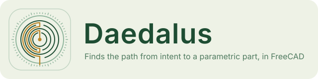

# Daedalus



An assistant that lives inside FreeCAD's own UI. You state an **Intent** in your own
words — "make a gear with 24 teeth" — and an agent builds it in your **Document** as a
series of **Steps**.

It is text-to-CAD, with one difference from the usual meaning of that phrase: the output
is a live parametric feature tree you can keep editing, not a dead mesh or an STL.

> This is a diploma project. The inspiration is MEDA (ASME IDETC-CIE 2025), which routes
> seven agents through a group chat. This runs one agent loop instead, with a kernel that
> rehearses every Step and an Assertion that must hold before the run may finish.

## Documentation

Everything about the project lives in the YouTrack knowledge base:

- [Overview](https://andriipytel.youtrack.cloud/articles/DAE-A-3): what Daedalus is, the Domains, how a run works, where to find what
- [Getting started](https://andriipytel.youtrack.cloud/articles/DAE-A-99): install, run from a script, run the gateway, test the panel by hand
- [Architecture](https://andriipytel.youtrack.cloud/articles/DAE-A-106): the agent loop, the Domains, the kernel, Apply, Lint, Tools, Events
- [Features](https://andriipytel.youtrack.cloud/articles/DAE-A-2), [Benchmarks and measurement](https://andriipytel.youtrack.cloud/articles/DAE-A-116)
- [Glossary](https://andriipytel.youtrack.cloud/articles/DAE-A-1), [Architecture Decisions](https://andriipytel.youtrack.cloud/articles/DAE-A-5), [Changelog](https://andriipytel.youtrack.cloud/articles/DAE-A-56)

Work is tracked in YouTrack project DAE.

---

## Install

FreeCAD 1.0, Python 3.11.

```bash
git clone <this repo> ~/Library/Application\ Support/FreeCAD/Mod/Daedalus
```

On Linux the addon directory is `~/.local/share/FreeCAD/Mod/`. A symlink from the Mod
directory to a checkout elsewhere works too, and is how this repo is developed.

Start FreeCAD and pick **Daedalus** from the workbench list. On first launch the addon
checks for `litellm`, `numpy` and `Pillow` and offers to install what is missing into
FreeCAD's own `AdditionalPythonPackages`.

Then open **Edit → Preferences → Daedalus → Providers**, paste an API key, and pick a
default model.

---

## Tests

```bash
.venv/bin/python -m pytest -q
```

**FreeCAD is never mocked.** The suite is layered instead:

- **Level 1** (436 tests, 8 seconds) — pure logic with no FreeCAD and no Qt at all: the
  loop over a scripted LLM client, the lint, the event stream, what an event says, the
  Sessions, the title call. This is where TDD happens.
- **Level 2** (209 tests, marked `@pytest.mark.freecad`, two and a half minutes) — run
  against a real FreeCAD: the Tools, the kernel worker, and the Qt panel built
  offscreen against FreeCAD's own PySide2 — its arithmetic and its state machine, not
  its appearance.
- **Level 3** — by hand. How a widget looks under a theme is not something a test can
  tell you.

Level 2 is skipped when FreeCAD is not importable. `conftest.py` finds it at
`/Applications/FreeCAD.app/Contents/Resources/lib` or `/usr/lib/freecad/lib`, or wherever
`FREECAD_LIB` points.

> **Known wrinkle.** `conftest.py` puts the checkout on `sys.path` *before* importing
> FreeCAD, and FreeCAD then puts the Mod directory in front of it. If your Mod entry is a
> symlink to a different checkout, Level 2 tests exercise that one instead of the one you
> are in. It matters when running the suite from a git worktree, and it is silent — the
> tests pass or fail against code you are not looking at.
>
> To run a worktree against itself, give FreeCAD a user directory of its own:
>
> ```bash
> mkdir -p /tmp/fcuser/Mod
> ln -sfn "$PWD" /tmp/fcuser/Mod/Daedalus
> ln -sfn ~/Library/Application\ Support/FreeCAD/v1-1/AdditionalPythonPackages /tmp/fcuser/
> FREECAD_USER_HOME=/tmp/fcuser .venv/bin/python -m pytest -q
> ```
>
> The second symlink is not optional: `AdditionalPythonPackages` is where `litellm`,
> `httpx`, `numpy` and `Pillow` live, and without it collection fails on the imports.

---

---

## Scope

**In scope:** one Document, one part, parametric solid modelling — Part Design in the
usual range (sketch → pad / pocket / revolve / fillet), plus Assemblies and BIM flats, and whatever you
have selected live.

**Out of scope for now:** TechDraw, FEM, mesh and Surface. Each is a separate
API vocabulary and a separate failure taxonomy. Nothing enforces this technically — a
Step runs arbitrary FreeCAD Python — it is the boundary of what is demonstrated.

**What this is not:** not a script generator (Python is how a Step is applied, not a
saved artifact); not a chatbot about FreeCAD; not an autopilot; not a cloud
service; not an abstraction layer over other CAD.

**Who it is for:** engineers who already use FreeCAD and are tired of clicking what one
sentence describes. Not beginners.
